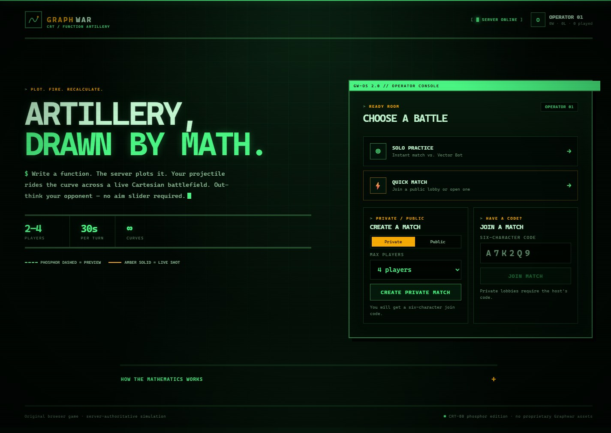
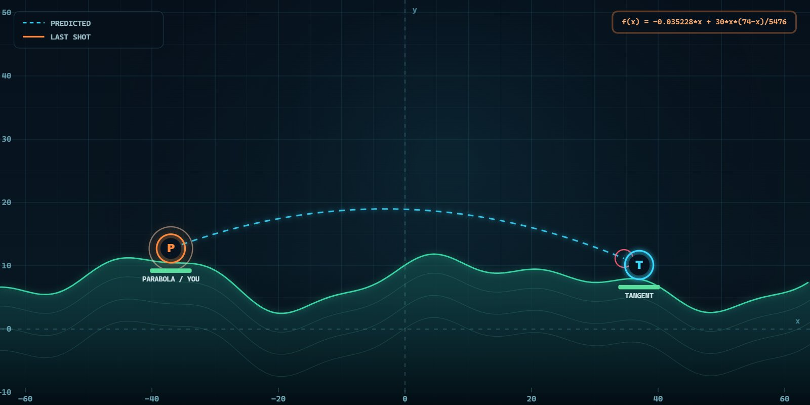

# Graphwar Web — Function Artillery

A complete, browser-based multiplayer artillery game inspired by Graphwar. Players do not choose an angle or power: they write a mathematical function, and the server plots it as a projectile path across a Cartesian battlefield.

Deployed link: https://graphwar-2-web-git-theme-retro-crt-iamaadityams-projects.vercel.app/

The project is an original implementation with no Graphwar assets or code. It includes a React client, an authoritative Node.js/Socket.IO server, a safe function parser, deterministic simulation, SQLite persistence, public/private lobbies, bots, reconnection, tests, and a production build. The interface is presented as a phosphor CRT computer terminal.

| Main terminal | Predicted trajectory |
| --- | --- |
|  |  |

## Features

- **Write-to-fire gameplay** — enter `f(x)`, choose left or right, preview the curve, and fire.
- **Server-authoritative results** — the server compiles every submitted expression, simulates the shot, applies damage, resolves victory, and broadcasts the canonical state. The client preview is never trusted.
- **Safe expression engine** — a hand-written tokenizer, parser, AST, and evaluator; no `eval`, `new Function`, or dynamic code execution. Length, complexity, numeric, domain, and non-finite checks are enforced.
- **Real multiplayer** — public matchmaking, six-character private join codes, 2–4 player lobbies, readiness, host start, rematches, and live state synchronization.
- **Solo practice** — instant match against a deterministic bot that only uses the same public snapshot and trajectory engine available to humans.
- **Reconnect and persistence** — opaque hashed-token accounts, saved sessions, reconnection to active matches, SQLite match snapshots, restart recovery, and exactly-once win/loss accounting.
- **Turn safety** — 30-second clocks, automatic harmless shots on timeout or prolonged disconnect, turn skipping for disconnected players, and abandonment of matches with no connected humans.
- **Responsive presentation** — React game UI, accessible controls, a 1280×640 canvas battlefield, terrain, grid, health bars, predicted paths, animated shots, ballistic history, and a results overlay.
- **CRT terminal theme** — phosphor-green and amber palette, scanlines, hard-edged window chrome, monospaced typography, and a matching battlefield palette.

## Quick start

Requirements: **Node.js 24+** (the server uses the built-in `node:sqlite` module) and npm.

```bash
npm install
npm run dev
```

Open <http://localhost:5173>. The Vite client proxies `/api` and `/socket.io` to the backend on port 3001.

Production:

```bash
npm run build
npm start
```

Open <http://localhost:3001>. `npm start` serves the built `dist/` directory when it exists. For local production, Socket.IO accepts the configured `PORT` automatically; use `CLIENT_ORIGIN` when serving through a different public hostname or reverse proxy.

### Configuration

Copy `.env.example` to `.env` if you need overrides. The server loads `.env` at startup using Node's built-in environment-file loader.

| Variable | Default | Purpose |
| --- | --- | --- |
| `PORT` | `3001` | HTTP and Socket.IO port |
| `DB_PATH` | `./data/graphwar.db` | SQLite database path |
| `CLIENT_ORIGIN` | auto | Extra comma-separated browser origins allowed by Socket.IO CORS; local Vite and the configured `PORT` are included automatically |
| `VITE_SERVER_URL` | same origin | Optional client Socket.IO URL, read at build time by Vite |
| `NODE_ENV` | unset | Used for startup logging; static hosting is detected from `dist/` |

For a cross-origin deployment, build the client with `VITE_SERVER_URL` pointing at the public server and add the client origin to `CLIENT_ORIGIN`. Put TLS in front of the process so browsers use HTTPS/WSS.

## How to play

1. Enter a display name. The browser stores an opaque session token and reuses it after reload.
2. Choose **Solo practice**, **Quick match**, or create/join a private lobby.
3. In a lobby, every human marks ready; the host starts the match.
4. On your turn, enter `f(x)`, for example `0.7*x - 0.02*x^2`, and choose a firing direction. The dashed preview is computed locally with the shared engine.
5. Fire. The projectile is sampled and collision-checked by the server. A hit deals 35 damage; units have 100 HP.
6. Last unit standing wins. A rematch resets units and returns everyone to the lobby.

## Mathematics and trajectory semantics

### Grammar

```
expression     := additive
additive       := multiplicative (("+" | "-") multiplicative)*
multiplicative := unary (("*" | "/") unary)*
unary          := ("+" | "-") unary | power
power          := primary ("^" unary)?
primary        := number
                | "x"
                | "pi" | "e" | "tau"
                | function "(" expression ")"
                | "(" expression ")"
```

- Operators: `+`, `-`, `*`, `/`, `^`.
- `^` is right-associative; unary minus is below exponentiation, so `-2^2 = -4` and `2^3^2 = 512`.
- Functions: `sin`, `cos`, `tan`, `asin`, `acos`, `atan`, `sqrt`, `abs`, `exp`, `ln`, `log`, `floor`, `ceil`, `round`, `sign`.
- Trigonometry uses radians. `ln` is natural log; `log` is base 10.
- Function names are case-insensitive. Multiplication must be explicit: use `2*x`, not `2x`.
- Implicit multiplication, variables other than `x`, and arbitrary identifiers are rejected.

### Bounds and validation

- Maximum expression length: 120 characters.
- Maximum AST: 160 nodes and 48 levels of nesting.
- Maximum evaluation: 2,000 AST operations per sample.
- Numeric magnitude limit: `1e7`; every intermediate result must be finite.
- Division by zero, `sqrt` of a negative number, `ln`/`log` of a non-positive number, and `asin`/`acos` outside `[-1, 1]` are rejected.
- An expression that is syntactically valid but enters an invalid numerical region mid-flight stops there and resolves as an `invalid` miss.

### Local coordinates

`x` is **horizontal distance travelled from the shooter**, not world X. For a shooter at `(sx, sy)`:

- Firing right: world position = `(sx + u, sy + f(u))`
- Firing left: world position = `(sx - u, sy + f(u))`

`u` starts at `0`, increases in deterministic `0.2` steps, and is capped at `132`. The first rendered point is exactly the shooter position; the first evaluated point is at `u = 0.2`. A function can therefore express a curve that looks different from a standard `y = f(x)` plot when firing left, while remaining symmetric under `f(|x|)`.

Example for a target 74 units to the right at the same height:

```
30*x*(74-x)/5476
```

This is a parabola with zeros at the shooter and target and a 30-unit peak. To account for a height difference `dy`, add `dy/74*x`.

### Collision and world rules

- World bounds: `x ∈ [-64, 64]`, `y ∈ [-12, 52]`.
- Unit collision radius: `2.25`; projectile radius: `0.35`; combined target radius: `2.6`.
- Collision checks use segment intersections between consecutive samples, so a fast curve does not tunnel through a unit or a hill at the configured step size.
- Units are checked before terrain within each sampled segment, so a hit at ground level counts as a hit.
- The shooter and eliminated units are never collision targets.
- A sample outside the chart ends the shot as `boundary`; exhausting the distance ends it as `range`; a domain/range error ends it as `invalid`.
- Damage is 35, capped at remaining health. Health reaching zero eliminates the unit.
- Spawn positions are deterministic and depend only on player count.

## Architecture

```text
client/                   React 19 + Vite browser client
  App.tsx                 session, reconnect, screen routing, Socket.IO actions
  components/             menu, lobby, game screen, math editor, canvas, results
  styles.css              responsive layout and structural design
  retro.css               CRT terminal theme, scanlines, phosphor palette
shared/                   pure TypeScript used by both sides
  types.ts                wire types, world/game constants
  math/expression.ts      bounded tokenizer, parser, AST evaluator
  game/world.ts           deterministic terrain, spawns, colors
  game/trajectory.ts      deterministic sampling and collision detection
  game/engine.ts          lobby/turn/shot/victory/rematch state machine
  game/bot.ts             deterministic public-state bot
server/
  index.ts                production entry point and graceful shutdown
  create-server.ts        Express, health endpoint, static hosting, Socket.IO
  socket.ts               protocol handlers, auth, rate limiting, broadcasts
  protocol.ts             strict Zod input schemas
  match-manager.ts        matchmaking, lobbies, bots, timers, cleanup, recovery
  store.ts                SQLite accounts, matches, hashed tokens, stats
tests/                    unit, integration, persistence, startup tests
```

### State flow

1. The client sends `profile:hello` with a new display name or a saved `accountId` + token. The server creates or authenticates the account, reconnects the player to any saved match, and returns a profile.
2. Lobby actions (`match:create`, `match:join`, `match:quick`, `match:solo`, `match:ready`, `match:start`, `match:rematch`, `match:leave`) update the authoritative `MatchState`.
3. The server persists the snapshot and broadcasts `match:state` to the Socket.IO match room.
4. A shot contains `matchId`, `turnNumber`, `version`, `expression`, and `direction`. Zod validates the shape; the engine additionally verifies membership, active status, current player, version, turn number, and connection.
5. The server compiles and simulates the expression, applies damage, checks victory, advances the turn, persists, and broadcasts the result.
6. Timeout and bot timers run on the server. Bots read only the public match snapshot and simulate candidates with the same engine before submitting.

### Persistence and cleanup

- SQLite runs in WAL mode with prepared statements.
- Accounts store SHA-256 token hashes, not plaintext tokens.
- Match snapshots include players, health, positions, turn state, version, shots, and events.
- `statsRecorded` prevents duplicate win/loss awards if a finished match is restored or saved repeatedly.
- On restart, waiting/active/finished matches are loaded; humans are marked disconnected, and active turn deadlines are extended so clients can reconnect.
- Abandoned matches are cleaned up: waiting lobbies after 15 minutes without connected humans, active matches after 2 minutes without connected humans, and finished matches after 1 hour.

### Security and robustness

- Strict Zod objects reject unknown fields and enforce size/type bounds; the Socket.IO buffer is capped at 16 KiB.
- Per-socket token-bucket rate limiting (burst 40, 8 actions/second refill).
- CORS allow-list for Socket.IO origins; common security headers on HTTP responses.
- Display names are sanitized and length-limited.
- A newer socket replaces an older socket for the same account and notifies the old tab.
- The deterministic engine is bounded in time, point count, AST size, and numeric range.
- No shell, filesystem, or dynamic-code access is exposed through expression input.

## Commands

| Command | Description |
| --- | --- |
| `npm install` | Install dependencies |
| `npm run dev` | Run backend and Vite client together |
| `npm run dev:server` | Backend only, with watch mode |
| `npm run dev:client` | Vite client only |
| `npm run build` | Typecheck, then create the production client in `dist/` |
| `npm start` | Run the production server; serves `dist/` when present |
| `npm test` | Run all automated tests once |
| `npm run test:watch` | Run Vitest in watch mode |
| `npm run typecheck` | TypeScript check without emitting |

## Tests and verification

`npm test` runs six files with 44 tests:

| File | Tests | Coverage |
| --- | ---: | --- |
| `tests/math.test.ts` | 12 | precedence, exponent associativity, functions, domain errors, complexity, safe input |
| `tests/trajectory.test.ts` | 11 | sampling, left/right semantics, unit/terrain/boundary/invalid outcomes, shooter exclusion |
| `tests/engine.test.ts` | 14 | lobbies, turns, duplicates/stale actions, damage, victory, timeout, disconnect, rematch, bot validity |
| `tests/persistence.test.ts` | 2 | restart recovery, reconnect, exactly-once stats, lobby TTL, join codes |
| `tests/integration.test.ts` | 4 | two independent Socket.IO clients, full match to victory, sync, unauthorized/duplicate actions, reconnect, public queue, solo bot, cleanup |
| `tests/application.test.ts` | 1 | real entry-point startup, health endpoint, security headers, API 404, built client hosting |

Latest verification:

- `npm test` — **44 passed** across 6 files.
- `npm run typecheck` — passed.
- `npm run build` — passed (client bundle approximately 314 kB JS / 50 kB CSS before gzip).
- Manual browser test — two independent origins (`http://localhost:3001` and `http://127.0.0.1:3001`, which have separate `localStorage` sessions) joined the same private lobby, synchronized turn state, completed a full match through elimination, displayed the same winner on both clients, and returned both clients to the lobby via rematch.
- Manual production test — `npm start` served the built client; the CRT menu, 1440 px desktop layout, 390 px mobile layout, canvas preview, trajectory prediction, shot animation, health updates, ballistic log, timeout auto-shot, and solo bot turn were exercised.

## Known limitations

- **Single-instance deployment.** Active matches live in process memory and SQLite is local; there is no Redis/Postgres adapter or cross-process locking for horizontal scaling.
- **Lightweight identity.** Accounts are display names plus an opaque browser token. There is no password, account recovery, email verification, OAuth, moderation, or ranked progression. Clearing site data loses access to that account.
- **No spectators, chat, friends, or ELO matchmaking.** Public quick match joins the newest open public lobby; it does not balance skill.
- **Simple bot.** The bot evaluates a fixed family of straight/quadratic candidates and picks the best simulated result. It is deterministic per match seed and does not plan across turns.
- **Timer granularity.** Server cleanup/turn expiry is checked on a 750 ms tick and bot shots are delayed by 1.2 seconds, so auto-shots can occur slightly after the displayed deadline. Client clocks are approximate.
- **No reconnect animation replay.** A reconnecting client receives the current snapshot and up to 12 retained shots, but it does not replay the animation of a shot that happened while offline.
- **Fixed battlefield aspect ratio.** The UI and canvas adapt to narrow viewports, but the battlefield remains a fixed 1280×640 game surface rather than a fully reflowing scene.
- **Expression ergonomics.** Multiplication is explicit, the alphabet is limited to documented functions/constants, and the 120-character cap constrains very complex curves.
- **Node requirement.** `node:sqlite` and the project's `engines` field require Node.js 24+.
- **Manual browser verification is not part of CI.** The automated integration suite uses real Socket.IO clients and the real server, while the visual two-tab check was performed manually.

## License and attribution

This is an original educational game implementation inspired by the concept of Graphwar. Graphwar and its assets belong to their respective owners; no proprietary assets are included.
